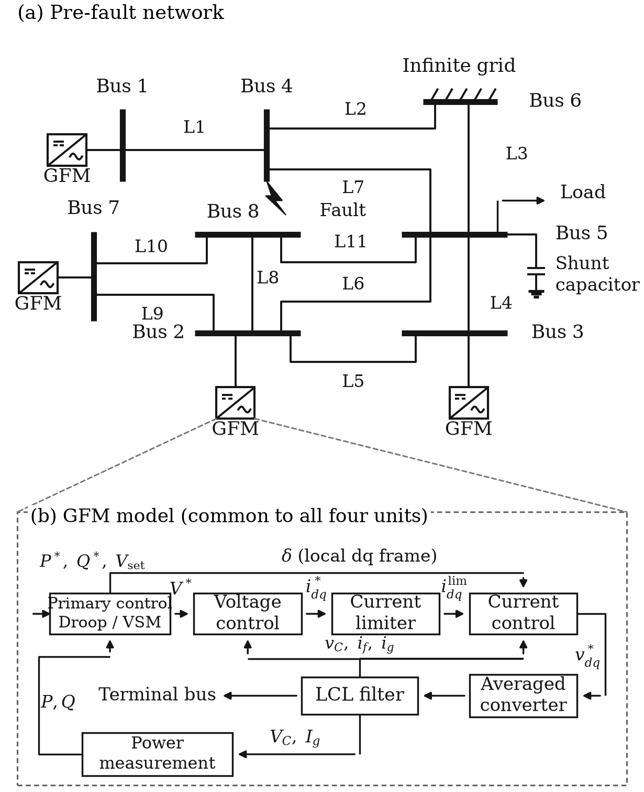

# GFM deceleration

Implementation accompanying **Fault-induced Decelerating Loss of Synchronism in Multi-Grid-Forming Inverter Systems**.

A common eight-bus model compares fault recovery and negative internal-angle rotation under Droop and virtual synchronous machine (VSM) control. The model retains LCL-filter and inner-controller dynamics, a current-command limiter, and network switching.

This repository is being aligned with the manuscript. The existing calculations and saved results are retained; the model explanation and manuscript-to-code correspondence are being organized. The documentation identifies the current scope and remaining verification.

## System and GFM model



All lines are connected in the pre-fault network. The lightning marker identifies the fault location at Bus 4; the fault is applied at 1.00 s and cleared at 1.15 s, when L7 (4–5) opens. The lower callout shows the common GFM control and electrical model. [Figure explanation and redraw command](docs/figure1.md).

## Start here

- [Model and assumptions](docs/model.md): what is simulated and where the equations are implemented.
- [Reproduce the results](docs/reproduction.md): environment, commands, and output locations.
- [Paper-to-code map](docs/paper-map.md): manuscript figures, inputs, saved data, and commands.

## Repository layout

| Location | Contents |
|---|---|
| [src](src/) | Shared model, integration, analysis, and plotting implementation |
| [studies](studies/) | Paper study: settings, executable scripts, saved results, and figures |
| [docs](docs/) | Model explanation, numerical verification, and reproducibility guidance |

New calculations and plots go into `studies/outputs/` (ignored by Git); saved study data remain read-only.

## Environment setup

The simulation inputs, implementation, and saved reference results are included in this repository. Install the tools below, then run the setup commands from the repository root. No files from another research workspace are required. Internet access is needed for the initial installation of Julia and dependency packages.

Prerequisites:

- Julia **1.12.5**. The commands below use Juliaup to select this version.
- Python **3.11 or later**, with `venv` and `pip`, for plotting and saved-data checks.
- A Bash-compatible shell and the `gzip` executable for Julia simulation workflows. On Windows, use WSL for these commands.

The environment is defined by three files:

| File | Role |
|---|---|
| [Project.toml](Project.toml) | Declares the Julia dependencies and compatibility requirements used by Julia's package manager, `Pkg` |
| [Manifest.toml](Manifest.toml) | Records the resolved Julia dependency versions, including transitive dependencies, for reproduction |
| [requirements.txt](requirements.txt) | Pins the Python packages used for plotting and analysis |

Keep both Julia files when reproducing the calculations. `--project=.` selects this repository's environment; `Pkg.instantiate()` installs the dependencies recorded in the manifest. These files manage the execution environment; the repository does not need to be installed as a registered Julia package.

### Julia environment

With Juliaup installed:

```bash
juliaup add 1.12.5
julia +1.12.5 --project=. -e 'using Pkg; Pkg.instantiate()'
```

If Julia 1.12.5 is installed directly, replace `julia +1.12.5` with that installation's `julia` command.

### Python environment

```bash
python3 -m venv .venv
. .venv/bin/activate
python -m pip install -r requirements.txt
```

Activate `.venv` again in each new shell before running the Python commands. Python-only replotting does not require the Julia environment.

## Run the calculations

Redraw the saved time responses:

```bash
python studies/scripts/plot.py --only time
```

This redraws saved time responses into `studies/outputs/figures/paper/`; it does not run a simulation.

Recompute case C with the Julia environment prepared above:

```bash
OPENBLAS_NUM_THREADS=1 julia +1.12.5 --project=. studies/scripts/run.jl cases.csv C
```

The new simulation results are written to `studies/outputs/runs/C/`. The saved reference results are not overwritten. Dependency versions are pinned for reproduction, but floating-point results can differ slightly across platforms; use the documented numerical checks when comparing results.

See the [reproduction guide](docs/reproduction.md) for phase-plane calculations and validation. Third-party component scope and license notices are in [third-party components](docs/third-party.md).
