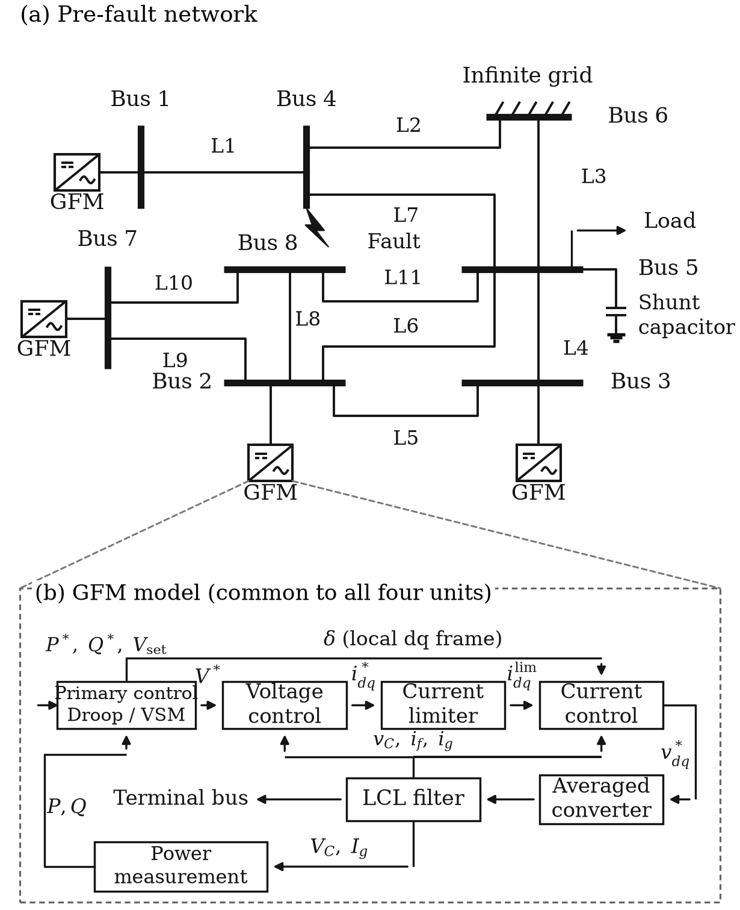

# Figure 1: system and GFM model



[Vector PDF](figures/system.pdf) · [Editable vector SVG](figures/system.svg) · [Drawing code](../studies/scripts/figure1.py).

## Network view

The diagram shows the pre-fault network: all eleven lines, including L7, are connected. Each of the four GFMs is represented by a rectangular DC/AC converter icon. This icon identifies an inverter-based resource; it does not introduce DC-source or PWM dynamics into the averaged simulation model. Bus 6 remains the fixed infinite-grid/slack boundary.

The lightning marker at Bus 4 indicates the location of the consuming shunt fault. It is a location annotation, rather than a drawn circuit branch or a claim of lightning as the physical fault cause. There is no grounded fault branch or line-switch symbol. The actual contingency remains unchanged: the fault is applied at 1.00 s and removed at 1.15 s, when L7 (4–5) opens. The capacitor's ground symbol remains part of the pre-fault circuit.

Lightning fault annotations and rectangular DC/AC converter icons appear in [EPRI's GFM tutorial](https://restservice.epri.com/publicdownload/000000003002021722/0/Product) and [NERC-hosted inverter presentations](https://www.nerc.com/globalassets/who-we-are/standing-committees/rstc/irps/20260226_irps_presentations.pdf). The present drawing is generated from this repository's own layout and model.

## GFM callout

The dashed callout expands the lower GFM at Bus 2 into the common model used by all four units:

- Primary control uses Droop or VSM and the shared Q–V path to provide voltage and internal-angle references.
- Voltage control generates a dq current command; the circular limiter acts on that command before the current controller.
- The current controller drives the averaged converter, which supplies the LCL filter and terminal bus.
- The internal angle defines the local dq frame. Electrical measurements feed the inner controls; capacitor voltage and grid-side filter current give `P + jQ = Vc conj(Ig)` for the primary-control feedback.

The view groups PI integrators, feedforward terms, and coordinate transformations into functional blocks; it adds no simulated states. Lowercase dq signals refer to the local control frame; uppercase `Vc` and `Ig` denote the complex electrical measurements used for power. Exact equations are in [dynamics.jl](../src/dynamics.jl), with conventions and scope in the [model guide](model.md).

## Redraw

After installing the Python environment, run from the repository root:

```bash
python studies/scripts/figure1.py
```

This explicitly updates `docs/figures/system.pdf`, `system.svg`, and `system.png`, without running Julia or modifying numerical reference data. Use `--output studies/outputs/figure1` for a separate preview. The figure is designed at approximately one IEEE column in width, with vector text in the PDF.

The manuscript uses a copy of the PDF as `figures/system.pdf`; keep that copy and its caption in sync when adopting a revised drawing.
